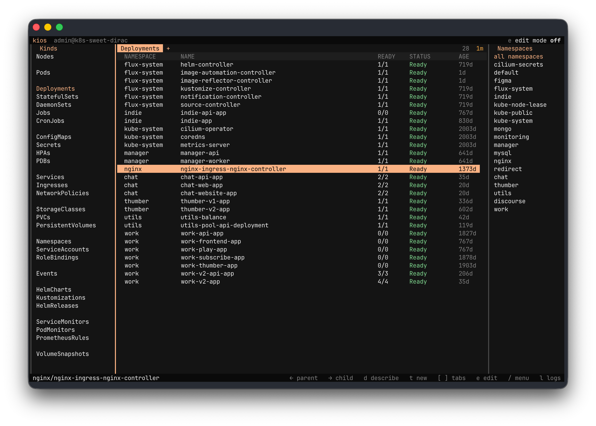

<p align="center"><samp>&nbsp;&nbsp;_&nbsp;&nbsp;&nbsp;_&nbsp;&nbsp;&nbsp;&nbsp;&nbsp;&nbsp;&nbsp;&nbsp;<br>&nbsp;|&nbsp;|_(_)___&nbsp;___<br>&nbsp;|&nbsp;/&nbsp;/&nbsp;/&nbsp;_&nbsp;(_-&lt;<br>&nbsp;|_\_\_\___/__/</samp></p>
<p align="center">TUI wrapper for kubectl</p>
<p align="center"></p>

---

### Installation

```bash
# Oneliner
curl -fsSL https://raw.githubusercontent.com/vsboldakov/kios/master/install | bash

# Package managers
npm i -g @vsboldakov/kios@latest
bun add --global @vsboldakov/kios@latest
brew tap vsboldakov/kios https://github.com/vsboldakov/kios && brew install kios
```

### About

Free, open-source TUI for managing Kubernetes. It wraps kubectl in a clear, navigable interface, so you get a far better view of your cluster than plain kubectl output, without the learning curve of k9s. It runs right in your terminal (no browser or desktop app), and the only requirement is kubectl binary.

- Open and free, unlike OpenLens
- Simpler and more user-friendly than k9s
- Terminal-native, unlike Hubble or kubewall
- A better view than raw kubectl, with live, navigable output

Built on [OpenTUI](https://opentui.com/). Requires only kubectl.

### Contributing

If you're interested in contributing to kios, please read the [contributing guide](./CONTRIBUTING.md) before submitting a pull request.
